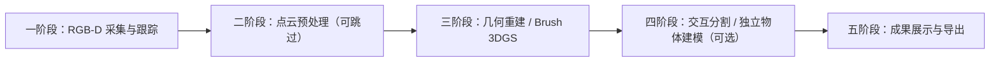

# 基于 RGB-D 的三维场景重建与交互建模

一个面向 RGB-D 相机的三维场景重建与交互建模项目，将数据采集、相机跟踪、点云预处理、场景重建、交互式物体分割和成果查看整合到同一工作台中。项目支持几何网格与 3D Gaussian Splatting 两类场景表达，并提供采集暂停续接、失跟恢复和完整数据集保存功能。

[观看项目演示视频](https://www.bilibili.com/video/BV1Crnt66E6A) · [安装说明](INSTALLATION.md) · [资源与模型](docs/RESOURCES.md) · [平台适配](docs/PORTING.md)

## 项目摘要

本项目以同步 RGB 图像和深度数据为输入，通过相机位姿估计与地图优化建立场景点云。用户可以对点云进行预处理，选择 Poisson、TSDF 或 NKSR 生成几何模型，也可以使用 Brush 训练 3DGS 场景。随后可在 RGB 图像中交互选中物体，借助 MobileSAM 完成分割，并按需调用 FAL 服务生成独立物体模型。

项目适合 RGB-D 场景重建、配准算法对比、三维场景表达与交互建模的开发和实验。当前主工作流基于 Windows 与 HP60C 相机验证；Linux 移植接口和适配说明已保留，完整实拍流程仍需在目标平台完成适配与验收。

## 功能描述

| 模块 | 主要功能 |
|---|---|
| RGB-D 采集 | 同步采集 RGB、深度与点云；相机启动后预热 1 秒；支持暂停、继续与数据集保存。 |
| 相机跟踪与建图 | 默认使用 RTAB-Map RGB-D 跟踪、iSAM2 优化和子地图融合；可选择 G-CVO CPU 前端，保留 CUDA 构建接口。 |
| 失跟恢复 | G-CVO 失跟后，尝试 RGB-D ORB/PnP 或 MAC + ICP；通过几何检查、质量评分和连续确认后恢复跟踪。 |
| 点云预处理 | 卡尔曼表面融合、均匀化及保特征精简；第二阶段可跳过。 |
| 几何场景重建 | 支持 Poisson、TSDF、NKSR，查看并导出几何结构。 |
| 3DGS 场景重建 | 集成 Brush，默认训练 8,000 步；在工作台右侧交互查看三维场景。 |
| 交互分割与建模 | 使用 MobileSAM 根据 RGB 图像提示分割物体；可选 FAL 云端精细建模，独立保存和展示物体结果。 |
| 成果管理 | 点云、几何结构、3DGS 和独立物体模型查看；数据集导入、导出与重新加载；几何和高斯结果分别保存。 |

BUFFER-X 作为实验前端保留，可用于配准对比；其 CPU 计算开销较高，使用前请阅读 [相关说明](docs/BUFFER_X.md)。各算法是否可用，取决于对应模型、原生库及运行环境是否已安装。

## 工作流程



主界面保留完整五阶段设置；Beta 界面用于精简演示，沿既定流程自动完成预处理和 Poisson 重建。第三阶段生成的场景结果与第四阶段生成的独立物体模型分别管理。

## 代码维护范围

当前公开主入口保留普通版与 Beta 五阶段工作流。本轮已移除独立像素对齐实验窗口、旧几何对照窗口、SuperCluster 自动分割链、将生成物体放回场景的替换模块，以及外置 Brush 查看器启动函数。当前物体分割使用 MobileSAM，FAL 结果独立查看，3DGS 使用内嵌场景视口。

PointDSC 旧配准链、旧网格着色、旧版界面/Beta 流程与 NoKSR 实验仍保留，暂未拆除其依赖。部分文件继续提供当前流程的共享能力；代码中保留这些实现不表示主界面会启用它们。详见 [维护与清理范围](docs/MAINTENANCE.md)。

## 环境要求

- **主开发平台：** Windows x64。使用现有 RTAB-Map 原生组件时，推荐 Python 3.12 x64，并安装 Tcl/Tk 与 Python Launcher。
- **通用依赖：** NumPy、SciPy、OpenCV、Pillow、PyTorch 等，见 `requirements*.txt`。
- **几何处理：** Open3D 与对应依赖，见 `requirements-geometry.txt`。
- **硬件与原生组件：** 实拍需要 HP60C SDK、匹配的配置文件，以及 RTAB-Map / GTSAM / 项目原生桥接。
- **可选组件：** G-CVO、Brush、MobileSAM、NKSR、BUFFER-X 等需按使用功能分别安装。CUDA 功能需兼容的 NVIDIA 环境；项目保留 CPU 路径，具体支持范围见专题文档。

本仓库不附带 Python 环境、厂商相机 SDK、预编译运行库或预训练权重。安装通用依赖可用于启动界面和检查源码；实拍与各模型功能还需要补齐下述资源。

## 快速开始

### 1. 准备项目与 Python 环境

获取仓库后进入包含 `main.py` 的项目目录。Windows PowerShell 中执行：

建议解压到不含中文和特殊字符的路径（例如 `C:\Projects\Reconst_3D`），以避免部分 OpenCV 和原生组件的路径兼容问题。

```powershell
py -3.12 -m venv .venv
.\.venv\Scripts\python.exe -m pip install --upgrade pip
.\.venv\Scripts\python.exe -m pip install -r requirements.txt -r requirements-models.txt -r requirements-geometry.txt
```

也可以使用 `install_windows.cmd` 创建项目环境并安装依赖。已有环境可通过 `RECONST_PYTHON` 指定完整解释器路径；环境选择和原生依赖配置见 [INSTALLATION.md](INSTALLATION.md)。

### 2. 按需安装相机、模型与原生库

| 使用目标 | 需要补齐的资源 |
|---|---|
| 相机采集与默认建图 | HP60C SDK / 配置、RTAB-Map、GTSAM iSAM2 与项目桥接程序。 |
| G-CVO CPU 跟踪 | 构建独立 CPU 求解库，参见 [G-CVO 安装与恢复](docs/GCVO.md)。 |
| MobileSAM 交互分割 | 执行以下资源下载脚本，获取固定官方源码与权重；脚本会检查权重哈希。 |
| Brush 3DGS | 获取对应平台的 Brush 程序，放到约定目录，参见 [Brush 集成](docs/BRUSH_3DGS.md)。 |
| NKSR / BUFFER-X | 按 [资源清单](docs/RESOURCES.md) 和专题文档分别部署。 |

```powershell
.\.venv\Scripts\python.exe tools\setup_mobilesam.py
```

相机 SDK、原生库和模型的下载来源、放置位置、校验要求及许可边界统一记录在 [docs/RESOURCES.md](docs/RESOURCES.md)。

### 3. 启动工作台

```powershell
.\.venv\Scripts\python.exe main.py
```

精简演示界面：

```powershell
.\.venv\Scripts\python.exe main.py beta
```

Windows 也可以双击 `start_main.cmd` 或 `start_beta.cmd`。程序打开后不会主动连接相机；点击开始扫描时才进入采集流程。

### 4. 采集、重建与查看

1. 开始扫描并缓慢移动相机，保持相邻视角的场景重叠；需要时暂停采集。
2. 完成后保存数据集，按需执行点云预处理。
3. 在第三阶段选择几何算法或 Brush 3DGS，生成场景结果。
4. 按需进入第四阶段，选择物体并进行分割或独立建模。
5. 在第五阶段切换查看场景与物体结果，导出模型或完整数据集。

### Linux 适配

Linux 需要自行创建 Python 环境并安装依赖，还需适配相机 SDK 绑定、原生进程通信，以及 WGL 显示后端。现阶段不能仅执行 `python main.py` 就视为完整 Linux 实拍部署完成。适配顺序与验收边界见 [docs/PORTING.md](docs/PORTING.md)。

## 配置与数据管理

- **数据保存：** 新采集写入 `results/数据名称`。迁移或重新导入时，应保留完整数据集目录及图像、深度、标定和位姿记录。
- **场景结果：** 几何模型与 Brush 高斯结果分别保存，互不覆盖；独立物体模型单独管理。
- **云端服务：** FAL 为可选功能。参考 `.env.example` 配置自己的 `FAL_KEY`，仅在明确提交建模任务时调用服务；实际密钥不得提交到仓库。
- **3DGS 操作：** 左键环绕、右键转头、中键平移、滚轮前后移动；按 `R` 或双击复位，`[` / `]` 切换保存的采集视角。

## 项目结构

```text
.
├── main.py                         # 主入口
├── scene_workbench.py              # 五阶段工作台
├── video_capture.py                # RGB-D 视频采集与暂停续接
├── gcvo_*.py / gcvo_native/         # G-CVO 接口、CPU 实现与恢复流程
├── mac_*.py                        # MAC 恢复模块
├── scene_reconstruction*.py        # 场景重建与界面
├── brush_reconstruction.py         # Brush 训练集成
├── gaussian_*.py                   # 高斯场景加载与显示
├── scene_segmentation.py           # 场景交互分割
├── tools/                          # 安装、构建、检查和验证工具
├── tests/                          # 回归测试
├── docs/                           # 功能、安装和适配文档
├── vendor/                         # 随源码提供的第三方代码与配置
└── third_party/licenses/           # 第三方许可证副本
```

## 验证与开发

补齐所需依赖后运行离线回归：

```powershell
.\.venv\Scripts\python.exe tools\run_tests.py
```

部分测试需要原生库或模型资源；依赖未齐时应先查阅对应模块说明。发布文件的完整性检查可使用：

```powershell
.\.venv\Scripts\python.exe tools\check_release.py
```

离线生成数据上的通过结果不代表实际手持采集的成功率。相机接入、暂停恢复和重建效果仍应在目标设备上实测；动态场景、遮挡、位姿误差及拍摄覆盖不足会影响结果。

## 更多文档

- [安装与部署](INSTALLATION.md) / [资源与模型](docs/RESOURCES.md) / [相机配置](docs/CAMERA_SETUP.md)
- [五阶段工作流](docs/SCENE_WORKFLOW.md) / [G-CVO 与失跟恢复](docs/GCVO.md)
- [Brush 3DGS](docs/BRUSH_3DGS.md) / [MAC](docs/MAC.md) / [BUFFER-X](docs/BUFFER_X.md)
- [Linux 平台适配](docs/PORTING.md) / [第三方材料说明](THIRD_PARTY_NOTICES.md)

## 开源协议

项目自行编写的代码采用 **[Apache License 2.0](LICENSE)**，项目声明见 [NOTICE](NOTICE)。第三方源码、模型、厂商 SDK 和外部服务分别遵守其原有许可及使用条款，本项目的 Apache 2.0 许可证不替代这些条款。

特别是 G-CVO 上游库、NKSR、PointDSC 和厂商相机 SDK，具有各自的许可或授权边界；本仓库的资源包含范围和获取方式见 [THIRD_PARTY_NOTICES.md](THIRD_PARTY_NOTICES.md)。
